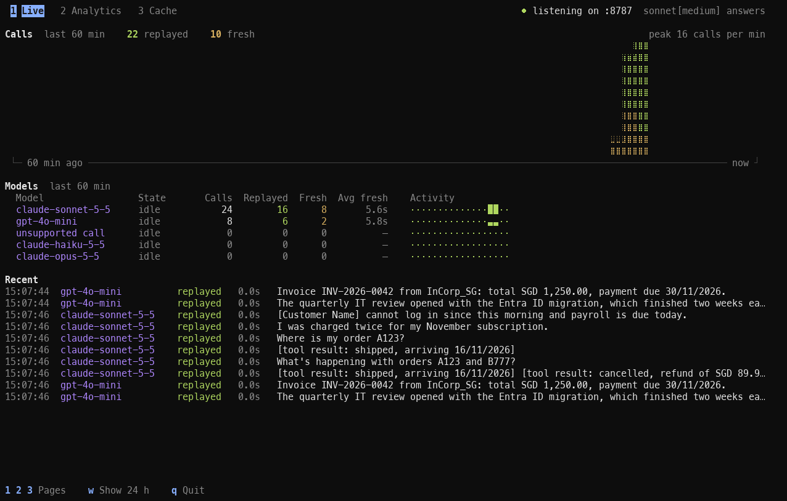
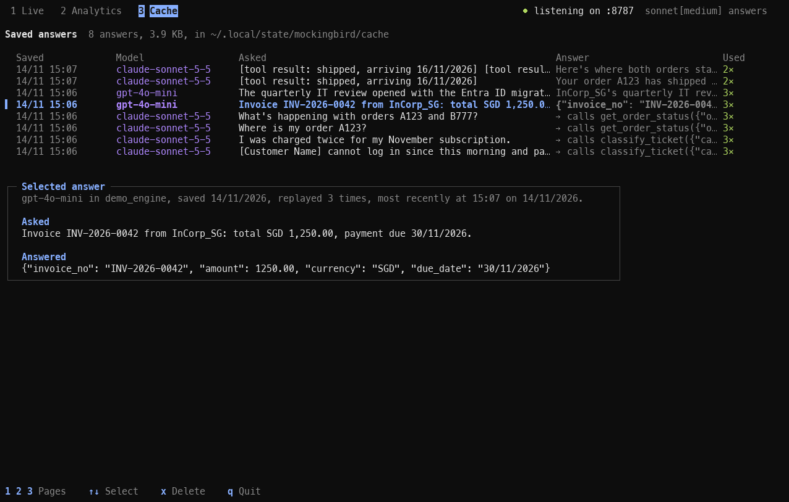

<pre align="center">
                         __   _             __    _          __
   ____ ___  ____  _____/ /__(_)___  ____ _/ /_  (_)________/ /
  / __ `__ \/ __ \/ ___/ //_/ / __ \/ __ `/ __ \/ / ___/ __  /
 / / / / / / /_/ / /__/ ,< / / / / / /_/ / /_/ / / /  / /_/ /
/_/ /_/ /_/\____/\___/_/|_/_/_/ /_/\__, /_.___/_/_/   \__,_/
                                  /____/
</pre>

<p align="center">
  <em>It mimics the API, so your tests don't need it.</em>
</p>

<p align="center">
  
  
  
  
</p>

Your app's AI features call Anthropic or OpenAI. In tests, that costs money, needs keys, and gives a different answer every run. mockingbird catches those calls on your machine, lets Claude Code, Codex or opencode answer through your existing login, and saves successful answers. Repeating the same request replays the saved content.

Your application code doesn't change. Route only your test process to the bridge using SDK environment variables or the optional hook.

<p align="center"></p>

## Install

Install the current code from `main`:

```bash
curl -fsSL https://raw.githubusercontent.com/19Naveen/MockingBird/main/install.sh | bash
```

To install this local checkout before its changes are pushed:

```bash
MOCKINGBIRD_SRC="$PWD" bash install.sh
```

The installer:

1. Puts the tool in `~/.agents/skills/mockingbird` and checks that Python can start it. The full tests run separately in CI.
2. Adds the `mockingbird` command to `~/.local/bin`.
3. Leaves shell startup files alone on a new install. The optional hook requires both installation and a per-process opt-in.
4. Puts the skill in the shared folder `~/.agents/skills`, which Codex and opencode read. Nothing goes into agent-specific folders.

To install the optional shell hook, run `mockingbird hook install` or set `MOCKINGBIRD_INSTALL_HOOK=1` during installation. An upgrade refreshes an existing global hook to add the opt-in guard. Reinstall any older per-environment hook with `mockingbird hook install /path/to/python`. Restart existing Python processes after upgrading.

The curl command downloads the installer and files from `main`, so it follows repository changes without a version in the URL. Read `install.sh` before you pipe it to bash. `mockingbird update` uses published release tags as described below.

## Use

```bash
mockingbird serve --model codex   # uses your configured Codex model

# In another terminal: route only this test process, with dummy keys.
ANTHROPIC_BASE_URL=http://127.0.0.1:8787 ANTHROPIC_API_KEY=bridge-dummy \
OPENAI_BASE_URL=http://127.0.0.1:8787/v1 OPENAI_API_KEY=bridge-dummy pytest
```

With these base URLs, stopping the server makes tests fail to connect. Remove the variables to return to the real API. For Azure, set `AZURE_OPENAI_ENDPOINT=http://127.0.0.1:8787` and `AZURE_OPENAI_API_KEY=bridge-dummy`.

If your app hard-codes its provider URL, use an optional hook in its Python environment:

```bash
mockingbird hook install .venv/bin/python
MOCKINGBIRD_ENABLED=1 .venv/bin/python -m pytest
```

The hook does not patch `httpx` or `httpx2` unless the process starts with `MOCKINGBIRD_ENABLED=1`. Leave this variable scoped to the test command. With the global shell hook, use `MOCKINGBIRD_ENABLED=1 bash -ic 'pytest'` (or `zsh -ic`) so the conditional `PYTHONPATH` setup runs. Hooked processes without the opt-in use their original destinations even while the bridge runs. Opted-in hooks fall back to the real API when the bridge stops; use dummy keys for tests that must never incur API charges.

| Command | What it does |
|---|---|
| `serve` | Starts the server and the dashboard. Sonnet answers, at medium effort |
| `serve --real` | Uses the real API with your own keys, and replays any call it has seen before ([below](#real-api-with-repeats-replayed)) |
| `serve --model opus[max]` | Picks the model and effort, such as `sonnet[high]` or `haiku` |
| `serve --plain` | Logs plain lines instead of drawing the dashboard (automatic with no terminal) |
| `serve --redact` | Disables disk cache reads/writes and hides model, project and error details in new history and logs |
| `serve --agent` | Lets a coding agent's subagents answer instead (see [SKILL.md](SKILL.md)) |
| `stats` | Prints the analytics for every call so far |
| `cache` | Lists the saved answers |
| `cache --purge` | Deletes every saved answer after asking (`--yes` skips the question). Your history stays |
| `update` | Installs the newest release. Your history and saved answers stay |
| `uninstall` | Removes mockingbird after asking. `--purge` also deletes your history and saved answers |
| `hook status` | Shows whether the hook is active in this terminal, and whether the server is on |
| `hook uninstall` | Removes the hook and restores your shell files exactly |
| `selftest`, `version` | Runs the built-in checks, prints the version |

## Which model answers

mockingbird answers through an AI plan you already have, using that plan's own command-line tool. You need no API key and pay no API bills. With no `--model`, it uses the first tool it finds:

| You have | mockingbird runs | Model it uses |
|---|---|---|
| Claude Code (a Claude plan) | `claude -p` | Sonnet at medium effort |
| Codex (a ChatGPT plan) | `codex exec` | The default model in your Codex config |
| opencode | `opencode run` | The default model in your opencode config, from any provider you set up there |
| None of these | agent mode | A coding agent's subagents answer instead (see [SKILL.md](SKILL.md)) |

To choose, pass `--model`: `sonnet[high]`, `opus[max]`, `haiku`, `codex`, `gpt-5[low]`, `opencode`, or `opencode/<provider>/<model>`.

The default prefers Claude Code when installed, then Codex, then opencode. Use `--model codex` to choose Codex explicitly. Codex runs with `--ephemeral --sandbox read-only`, using its configured model. These flags avoid session persistence and restrict filesystem writes; they do not make untrusted requests safe. See the [official Codex non-interactive documentation](https://learn.chatgpt.com/docs/non-interactive-mode).

**Previously tested with opencode** 2.3.0 and its default model on 14/11/2026: six demo tests covering tool loops, JSON mode and streaming passed, with the second run replaying in under a second. The reproducible Codex SDK check is in [tests/codex_smoke.py](tests/codex_smoke.py); results are recorded below.

**Tested with Codex** CLI 0.169.0 on 14/11/2026, using its configured default model, Python 3.13.11, `anthropic` 2.8.0 and `openai` 3.51.0. All six SDK tests passed: Anthropic text and streaming, OpenAI JSON and streaming, and forced tool calls followed by a tool-result turn for each provider.

| Codex SDK check | Result | Time |
|---|---|---|
| Empty cache, 8 SDK requests | 6 fresh generations, 2 replays; 6/6 tests passed | 43.23 s |
| Same suite again, 8 SDK requests | All replayed, zero Codex invocations; 6/6 tests passed | 0.02 s |

These checks use SDK base URLs. Hook activation and isolation are covered separately by the regression suite. They verify these common SDK paths, not every API feature or SDK version.

## Real API, with repeats replayed

Working on one stage of a pipeline that calls a real model? Run:

```bash
mockingbird serve --real
```

Route the test process to the bridge using the base URLs above or the opted-in hook, but keep your real API keys for this mode. mockingbird sits in front of the real Anthropic, OpenAI or Azure OpenAI API:

- A call that's identical to an earlier one is **replayed** from the cache: instant, and no API cost.
- A call that's new or changed goes to the **real API** with your key, and the answer is saved for next time.
- Errors (401, 429, 500…) go straight back to your app and are never saved, so its own retries work as usual.

For example, say a pipeline makes 10 calls and you're editing the prompt in call 5. On the next run, calls 1 to 4 are replayed and call 5 goes to the real API. Calls 6 to 10 usually go too, because their input includes call 5's new answer. Replaying them would feed old answers downstream.

To get a fresh answer for one call, select it on the Cache tab and press `x` twice. `mockingbird cache --purge` clears them all.

**Keys and data:**
- Your key and other headers are forwarded only to `api.anthropic.com`, `api.openai.com` or `*.openai.azure.com` (or to `BRIDGE_UPSTREAM_ANTHROPIC` / `BRIDGE_UPSTREAM_OPENAI` if you set them).
- Keys are never written to disk or logs, and key fragments that providers echo in error messages are scrubbed.
- Real answers are kept apart from stand-in answers, so neither is ever replayed in place of the other.
- The cache holds real output from your pipeline. Treat `~/.local/state/mockingbird/cache` like the data the pipeline handles, and clear it when you're done.

## The dashboard

Every call ends one of three ways, and the dashboard uses the same word and colour for it everywhere:

| | |
|---|---|
| **replayed** (green) | Answered from the cache, instantly |
| **fresh** (amber) | Answered by the model just now |
| **failed** (rose) | Returned an error to your app |

It has three tabs. Switch with `1` `2` `3` or `l` `a` `c`, the arrow keys, Tab, or a click.

**1 Live** shows what's happening now. It has a chart of calls (replayed stacked under fresh), a row per model with its state (`asking 4s`, `failed`, `idle`), and the last ten calls with what each one asked. Press `w` to switch between the last 60 minutes, 24 hours and 7 days. The top right shows the server's state: `● listening`, or `● asking` while a call is being answered.

**2 Analytics** covers every call so far: the replay rate, time saved, the last 14 days, how fast fresh answers are per model, how often each model is replayed, failed calls, and projects.

<p align="center"></p>

**3 Cache** lists every saved answer: when it was saved, the model, what was asked, the answer, and how often it was replayed. Use ↑ ↓ to select one and read it in full below. Press `x` twice to delete it, and the next identical call is asked fresh.

<p align="center"></p>

The screenshots come from a real run of the demo test suite.

## Let an agent run it

```
/mockingbird sonnet[high] pytest tests/ai
/mockingbird haiku                         # effort defaults to medium
```

The agent starts the server, routes your app to it, runs the tests, reports the results and cleans up. Codex and opencode find the skill in `~/.agents/skills`; in Codex, type `$mockingbird`. Claude Code doesn't read that folder, so there, run the `mockingbird` command yourself. The full steps are in [SKILL.md](SKILL.md).

## How it works

```
 your app (unchanged) ── Anthropic / OpenAI / Azure SDK
        │
        │  optional hook: opted in AND server running?
        ├── no  ─► the real API
        └── yes ─► mockingbird on 127.0.0.1:8787
                     1. seen this exact call before? replay the saved answer
                     2. otherwise ask Claude Code, Codex or opencode
                     3. check the reply, and retry once if it's malformed
                     4. return it as a real API response, JSON or streaming
```

- **No code changes.** SDK base URLs affect only the test command. The optional hook patches Python HTTP clients only in opted-in processes, and checks server state before redirecting each call. Stand-in CLI subprocesses do not inherit the hook opt-in or bridge base URLs.
- **The model writes only the content.** mockingbird builds the common API response fields, tool calls and SSE events. This is a compatibility subset, not an exact provider emulator.
- **Other languages:** point the SDK at the server instead, with `ANTHROPIC_BASE_URL=http://127.0.0.1:8787` or `OPENAI_BASE_URL=http://127.0.0.1:8787/v1`.

## Cache and history

- **Saved answers** live in `~/.local/state/mockingbird/cache/`, one cache for all projects. Delete one on the Cache tab, or all of them with `mockingbird cache --purge`. `BRIDGE_CACHE=off` turns the cache off. `BRIDGE_CACHE=./fixtures` keeps a separate cache in that folder, for example to commit for CI.
- **Call history** lives in `~/.local/state/mockingbird/calls.db`. It powers the dashboard and keeps only metadata: time, model, outcome, duration, project, and tool names. It never stores prompts or answers.
- Cache filenames are SHA-256 hashes of the full request JSON, excluding `stream` in stand-in mode. They do not contain the request JSON. Each cache entry does contain the first 500 characters of the last user message and the **full answer in plaintext**. Newly written cache/queue files use owner-only permissions (`0600`).
- Concurrent identical successful requests within one server share one generation, including with `BRIDGE_PARALLEL`. Real mode also coalesces successful misses; streamed and plain real responses use separate entries. Separate server processes do not share locks: give them separate `BRIDGE_CACHE` directories. Failed requests are not cached or coalesced into future successes.
- Replay preserves saved answer content and tool IDs. Response envelope IDs and timestamps can differ. Purging or disabling the cache, changing the request, or using a different empty cache generates a fresh answer. Use deterministic test inputs instead of timestamps or random IDs when repeatability matters.

For data you do not want cached, use `mockingbird serve --redact` (or `BRIDGE_REDACT=1`). It bypasses existing cache entries, saves no new prompts or answers in the cache, and hides model, project, tool names and error details in new journal records and bridge logs. Every call is fresh. It does **not** erase older cache/history, anonymize data sent to the CLI/provider, or control the application's own logging. Agent mode temporarily queues full requests on disk; opencode temporarily uses a prompt file. Use synthetic data even with redaction.

## Speed

Measured on 14/11/2026: a demo app using the official `anthropic` and `openai` SDKs, with six tests making 8 AI calls (forced tool choice, two multi-turn tool loops, JSON mode and streaming). Sonnet answered at high effort.

| Run | Result | Time |
|---|---|---|
| First run, every answer fresh | 6 of 6 passed, about 7 s per call | 62 s |
| Second run, every answer replayed | 6 of 6 passed | **under 2 s** |

## Limits

| What | What happens |
|---|---|
| Answers come from a stand-in model | Fresh answers vary and only imitate your real model. Test your app's flow and parsing, not answer quality |
| Unsupported endpoints | Responses API, `count_tokens`, embeddings, Gemini, Bedrock and Vertex get a clear 501 error |
| Unusual requests | Images arrive as data the model can't see, very long contexts can overflow it, and token usage is always 0 |
| Exact SDK/provider fidelity | Stand-in mode supplies common fields with zero usage, emits text/tool arguments in coarse chunks, and does not generate native thinking blocks. `raw` answers can supply full response bodies, but streaming still uses the bridge's event builder. `--real` preserves upstream body/usage/SSE bytes, buffering the response before delivery; it does not preserve chunk timing or all HTTP headers |
| Calls that change every run | Requests containing timestamps or random ids never match a saved answer, so they're always asked fresh |
| Apps not started from a terminal | Set SDK base URLs in the test process, or install a hook in that Python environment and start the process with `MOCKINGBIRD_ENABLED=1` |

## Safety and data

- Hooks are off without `MOCKINGBIRD_ENABLED=1`; do not export this variable globally or enable the hook in production. Opt-in reduces accidental interception, and is not a security boundary.
- The server only accepts connections from your own machine.
- Prompts go to the provider behind your selected CLI. Cache entries contain prompt previews and complete answers; use synthetic test data or disable caching with `--redact`.
- Full requests, including untrusted tool results, enter the stand-in prompt. Instructions tell it to treat them as simulation data, but prompt injection can still alter replies or induce CLI tool use. Do not feed hostile content or secrets to a CLI that has access to sensitive files, tools or networks.

## Tests and license

```bash
python3 -m unittest discover -s tests -v
bash -n install.sh uninstall.sh
```

Named regression tests cover hook opt-in and upgrade, parsing and validation, concurrent cache misses in both modes, redaction, atomic private files, release-pinned updates, and the legacy self-check. GitHub Actions is configured to run them on Python 3.9–3.14 without model access. Installation only checks startup; it no longer runs network/listener tests on the user's machine.

Local verification on 14/11/2026: all 16 regression tests passed on Python 3.9.25 and 3.14. The GitHub Actions matrix has not been run for this unpublished checkout.

To repeat the live Codex check (requires a logged-in Codex CLI and consumes plan usage):

```bash
uv run --with anthropic --with openai python tests/codex_smoke.py
```

It uses dummy SDK keys, an isolated temporary bridge/cache, and both official SDKs. The second pass fails if it attempts any fresh generation. Live checks are opt-in and excluded from CI.

Licensed under [MIT](LICENSE).

## Update and uninstall

```bash
mockingbird update               # discovers the newest GitHub release, installs from its exact tag
mockingbird uninstall            # asks first, then removes everything; keeps history and saved answers
mockingbird uninstall --purge    # also deletes your history and saved answers
```

`update` reads release metadata from GitHub's releases API, validates a `vMAJOR.MINOR.PATCH` tag and matching installer version, and downloads the installer and payload files from that tag. It never executes an installer fetched from `main`. Tags can still be moved by repository maintainers; this is version pinning, not signature verification.

Uninstall restores `~/.bashrc` and `~/.zshrc` exactly as they were. If the `mockingbird` command itself is broken, run the uninstaller straight from GitHub:

```bash
curl -fsSL https://raw.githubusercontent.com/19Naveen/MockingBird/main/uninstall.sh | bash -s -- --yes
```
