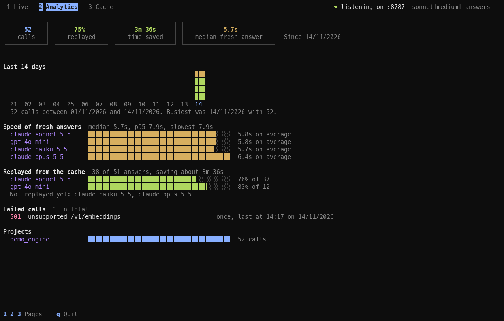

<pre align="center">
                         __   _             __    _          __
   ____ ___  ____  _____/ /__(_)___  ____ _/ /_  (_)________/ /
  / __ `__ \/ __ \/ ___/ //_/ / __ \/ __ `/ __ \/ / ___/ __  /
 / / / / / / /_/ / /__/ ,< / / / / / /_/ / /_/ / / /  / /_/ /
/_/ /_/ /_/\____/\___/_/|_/_/_/ /_/\__, /_.___/_/_/   \__,_/
                                  /____/
</pre>

<p align="center">
  <strong>Local LLM API bridge, record/replay proxy &amp; fault simulator</strong><br>
  <em>It mimics the API, so your tests don't need it.</em>
</p>

<p align="center">
  
  
  
  
  
</p>

Your app's AI features call Anthropic, OpenAI, Azure AI Foundry, Amazon Bedrock or Google Gemini. Testing against those APIs is slow, non-deterministic and burns credits. **MockingBird** catches the calls locally, lets Claude Code, Codex or opencode answer through your existing login, and saves successful answers. Repeating a request replays the saved content instantly — no model, no keys, no network.

Your application code doesn't change. Route only the test process to the bridge with SDK environment variables or the optional hook.

<p align="center"></p>

## What you get

- **No extra API spend:** fresh answers come from the Claude Code, Codex or opencode plan you already have.
- **No code changes:** route only the test process with SDK base URLs, in any language; the optional Python hook catches hard-coded provider URLs.
- **Deterministic record and replay:** identical requests return saved answers; CI needs no model login, API key or network. A replay miss fails fast with HTTP `409`.
- **Five provider surfaces:** Anthropic Messages, OpenAI Chat Completions, Azure OpenAI/Foundry, Gemini/Vertex AI and Amazon Bedrock Converse, including SSE streaming, tool calls and image, text and PDF inputs.
- **Real-API caching:** `--real` replays unchanged steps and forwards only new or changed calls with your own keys.
- **Fault injection:** `--faults` scripts rate limits, outages, latency and malformed bodies without touching application code.
- **Stdlib only:** Python 3.9+, zero runtime dependencies, and a live terminal dashboard.

## Install

MockingBird needs Python 3.9+ and no third-party Python packages. Poppler is optional, for PDF inputs.

Install the current code from `main`:

```bash
curl -fsSL https://raw.githubusercontent.com/19Naveen/MockingBird/main/install.sh | bash
```

To install this local checkout before its changes are pushed:

```bash
MOCKINGBIRD_SRC="$PWD" bash install.sh
```

The installer:

1. Puts the tool in `~/.agents/skills/mockingbird` and checks that Python can start it. The full tests run separately in CI.
2. Adds the `mockingbird` command to `~/.local/bin`.
3. Leaves shell startup files alone on a new install. The optional hook requires both installation and a per-process opt-in.
4. Puts the skill in the shared folder `~/.agents/skills`, which Codex and opencode read. Nothing goes into agent-specific folders.

To install the optional shell hook, run `mockingbird hook install` or set `MOCKINGBIRD_INSTALL_HOOK=1` during installation. An upgrade refreshes an existing global hook to add the opt-in guard. Reinstall any older per-environment hook with `mockingbird hook install /path/to/python`. Restart existing Python processes after upgrading.

The curl command downloads the installer and files from `main`, so it follows repository changes without a version in the URL. Read `install.sh` before you pipe it to bash. `mockingbird update` uses published release tags as described below.

## Use

```bash
mockingbird run --model codex -- pytest
```

`run` starts a private bridge on a free port, routes only the command and its children, then stops it and returns the command's exit code. It sets SDK base URLs and dummy keys, and loads the opt-in Python hook for hard-coded provider URLs. It needs no installed hook, shell-file changes, or separate terminal. `run --real -- pytest` keeps your own API keys. Ctrl-C also stops the command and bridge; CLI subprocesses are cleaned up with the bridge.

For a persistent dashboard and manual test runs:

```bash
mockingbird serve --model codex   # uses your configured Codex model

# In another terminal: route only this test process, with dummy keys.
ANTHROPIC_BASE_URL=http://127.0.0.1:8787 ANTHROPIC_API_KEY=bridge-dummy \
OPENAI_BASE_URL=http://127.0.0.1:8787/v1 OPENAI_API_KEY=bridge-dummy pytest
```

With these base URLs, stopping the server makes tests fail to connect. Remove the variables to return to the real API. For Azure, set `AZURE_OPENAI_ENDPOINT=http://127.0.0.1:8787` and `AZURE_OPENAI_API_KEY=bridge-dummy`.

Native provider SDKs use their own endpoints:

| Provider surface | Route the SDK calls | Test-process environment |
|---|---|---|
| Azure AI Foundry (OpenAI v1 and Azure Inference) | `/openai/v1/...`, `/models/...` | `AZURE_AI_ENDPOINT=http://127.0.0.1:8787/models` or `OPENAI_BASE_URL=http://127.0.0.1:8787/openai/v1` |
| Azure AI Foundry (Anthropic) | `/anthropic/v1/messages` | `ANTHROPIC_FOUNDRY_BASE_URL=http://127.0.0.1:8787/anthropic` |
| Gemini Developer API | `/v1beta/models/<model>:generateContent` | `GOOGLE_GEMINI_BASE_URL=http://127.0.0.1:8787` |
| Vertex AI Gemini | `/v1/projects/.../publishers/google/models/...` | `GOOGLE_VERTEX_BASE_URL=http://127.0.0.1:8787` |
| Amazon Bedrock Runtime | `/model/<model>/converse`, `/converse-stream` | `AWS_ENDPOINT_URL_BEDROCK_RUNTIME=http://127.0.0.1:8787` |

Set the matching dummy key as well: `ANTHROPIC_FOUNDRY_API_KEY`, `GOOGLE_API_KEY`, `GEMINI_API_KEY`, or `AWS_ACCESS_KEY_ID` / `AWS_SECRET_ACCESS_KEY` to `bridge-dummy`. For Bedrock, set `AWS_EC2_METADATA_DISABLED=true` so boto3 does not look for instance credentials. Vertex AI uses Application Default Credentials: the opt-in hook supplies dummy credentials while the bridge runs; without the hook, pass a dummy token in the test client. `mockingbird run` sets all of these for the child command.

If your app hard-codes its provider URL, use an optional hook in its Python environment:

```bash
mockingbird hook install .venv/bin/python
MOCKINGBIRD_ENABLED=1 .venv/bin/python -m pytest
```

The hook does not patch `httpx` or `httpx2` unless the process starts with `MOCKINGBIRD_ENABLED=1`. Leave this variable scoped to the test command. With the global shell hook, use `MOCKINGBIRD_ENABLED=1 bash -ic 'pytest'` (or `zsh -ic`) so the conditional `PYTHONPATH` setup runs. Hooked processes without the opt-in use their original destinations even while the bridge runs. Opted-in hooks fall back to the real API when the bridge stops; use dummy keys for tests that must never incur API charges.

| Command | What it does |
|---|---|
| `run [serve options] -- COMMAND` | Runs a command against its own temporary bridge, then cleans up |
| `serve` | Starts the server and dashboard. With no `--model`, the first available CLI answers (Claude Code → Codex → opencode), or agent mode if none is installed |
| `serve --real` | Uses the real API with your own keys, and replays any call it has seen before ([below](#real-api-with-repeats-replayed)) |
| `serve --model opus[max]` | Picks the model and effort, such as `sonnet[high]` or `haiku` |
| `serve --plain` | Logs plain lines instead of drawing the dashboard (automatic with no terminal) |
| `serve --redact` | Disables disk cache reads/writes and hides model, project and error details in new history and logs |
| `serve --replay --model codex` | Replays recorded Codex answers offline; a miss returns HTTP 409 |
| `serve --faults faults.json` | Applies an explicit sequence of errors, delays or malformed responses |
| `serve --agent` | Lets a coding agent's subagents answer instead (see [SKILL.md](SKILL.md)) |
| `stats` | Prints the analytics for every call so far |
| `cache` | Lists the saved answers |
| `cache --purge` | Deletes every saved answer after asking (`--yes` skips the question). Your history stays |
| `update` | Installs the newest release. Your history and saved answers stay |
| `uninstall` | Removes mockingbird after asking. `--purge` also deletes your history and saved answers |
| `hook status` | Shows whether the hook is active in this terminal, and whether the server is on |
| `hook uninstall` | Removes the hook and restores your shell files exactly |
| `selftest`, `version` | Runs the built-in checks, prints the version |

## Which model answers

mockingbird answers through a CLI you already have configured, using its own login or provider. It needs no separate API key. With no `--model`, it uses the first tool it finds:

| You have | mockingbird runs | Model it uses |
|---|---|---|
| Claude Code (a Claude plan) | `claude -p` | Sonnet at medium effort |
| Codex (a ChatGPT plan) | `codex exec` | The default model in your Codex config |
| opencode | `opencode run` | The default model in your opencode config, from any provider you set up there |
| None of these | agent mode | A coding agent's subagents answer instead (see [SKILL.md](SKILL.md)) |

To choose, pass `--model`: `sonnet[high]`, `opus[max]`, `haiku`, `codex`, `gpt-5[low]`, `opencode`, or `opencode/<provider>/<model>`.

The default prefers Claude Code when installed, then Codex, then opencode. Use `--model codex` to choose Codex explicitly. Codex runs with `--ephemeral --sandbox read-only`, using its configured model. These flags avoid session persistence and restrict filesystem writes; they do not make untrusted requests safe. See the [official Codex non-interactive documentation](https://learn.chatgpt.com/docs/non-interactive-mode).

The reproducible live checks are in [tests/smoke/sdk_smoke.py](tests/smoke/sdk_smoke.py). They cover both official SDKs, async clients and streams, streamed tool calls, tool-result loops, Azure deployment routes, eight concurrent identical requests, image recognition, text files and rendered PDFs. Each suite runs again in offline replay mode; it fails if any fresh generation is attempted.

**Tested on 14/11/2026**, using Python 3.13.11, `anthropic` 2.8.0 and `openai` 3.51.0:

| SDK check | First run | Offline replay |
|---|---|---|
| Codex CLI 0.169.0, configured default model | 17/17 tests, 14 generations, 106.69 s | 17/17 tests, 0 generations, 0.08 s |
| opencode 2.3.0, `openai/gpt-6.1-sol` | 17/17 tests, 14 generations, 40.20 s | 17/17 tests, 0 generations, 0.09 s |
| Claude Code 2.1.325 | Blocked: no active login; shell model overrides are unrecognized | Pending |

These checks use SDK base URLs. Hook activation and runner isolation are covered separately by the regression suite. They verify these common SDK paths, not every API feature or SDK version.

Provider-native checks also run entirely against local fake stand-ins and need no cloud login or credentials:

| Check | Command | Result on 14/11/2026 |
|---|---|---|
| Gemini Developer API and Vertex AI | `uv run --with google-genai python tests/smoke/google_smoke.py` | 8/8 fresh and 8/8 replay for each mode, with 0 generations in replay (`google-genai` 3.3.0) |
| Azure AI Foundry | `uv run --with azure-ai-inference --with aiohttp --with openai --with anthropic python tests/smoke/foundry_smoke.py` | 9/9 fresh and 9/9 replay, sync and async, hard-coded host redirects, and 5 runner-routed SDK calls |
| Amazon Bedrock | `uv run --with boto3 python tests/smoke/bedrock_smoke.py` | Converse, ConverseStream, tool loops, native throttling errors and runner routing passed with environment and hard-coded endpoints (`boto3` 1.44.3) |

Opencode's default text model passed the original 11 text/SDK tests but failed image/PDF checks. Selecting a vision-capable model made all 17 tests pass; the bridge cannot add vision to a text-only stand-in.

## Offline replay and CI

Record once, then replay with the same model selection and namespace:

```bash
BRIDGE_CACHE=./fixtures mockingbird run --model codex -- pytest
BRIDGE_CACHE=./fixtures mockingbird run --replay --model codex -- pytest
```

The second command needs no model CLI, login or provider network access. A cache miss returns HTTP **409** immediately, without generating an answer or forwarding to a real API. `--real --replay` replays real-response fixtures only. Replay requires a cache and cannot be combined with `--redact`. Review fixtures for private data before committing them; the cache's `.gitignore` excludes them by default.

Keys include the API, selected CLI command, explicit model/effort, and `BRIDGE_NAMESPACE`. To invalidate fixtures when changing a CLI's configured default model, set a new namespace (for example `BRIDGE_NAMESPACE=codex-default-v2`), or use an explicit `--model`. Old stand-in caches without backend identity stay viewable but are not automatically replayed by v1.14.

## Scripted failures

Fault simulation is **off by default**. Enable it only for the test run that needs it:

```bash
mockingbird run --model codex --faults faults.json -- pytest
```

Example `faults.json`:

```json
[
  {"status": 429, "error": "rate limited"},
  {"status": 503, "error": "temporarily unavailable"},
  {"delay": 2},
  {"body": "not valid JSON"}
]
```

Each incoming API request consumes one step, including SDK retries. A delay-only step waits then proceeds normally; a `status`/`error` step returns a provider-shaped error; `body` sends that literal string as JSON content (status 200 unless overridden). Injected responses never enter the cache. After the list ends, behavior is normal; starting a new run resets the sequence. Parallel requests consume steps in arrival order, so use an isolated sequential test when order matters. Delays are bounded by `BRIDGE_TIMEOUT`.

This simulates your application's error handling. It does not enforce requests-per-minute quotas or cause actual provider throttling. Faults run before cache lookup and real forwarding; with `--replay`, cache misses still never reach a model or upstream.

## Image and file inputs

Stand-in requests can include real image/document content, not just text descriptions:

| SDK input | Supported form |
|---|---|
| Anthropic image blocks | `source.type=base64`, with PNG, JPEG, GIF or WebP data |
| OpenAI Chat Completions images | `image_url.url` containing a base64 `data:image/...` URL |
| Anthropic documents | UTF-8 `source.type=text`, or base64 text/PDF data |
| OpenAI Chat Completions files | Inline `file.file_data` (base64 or data URL), with `filename` identifying text/PDF type |
| Gemini `inlineData` | Base64 data with a `mimeType`, in camelCase or Vertex snake_case form |
| Bedrock content blocks | Inline `image` or `document` with `source.bytes` or `source.text` |

Text files are decoded into the stand-in prompt. Image files are passed through Codex's image flag, opencode's file attachments, or Claude's structured image input. In agent mode, numbered temporary image paths are exposed for the answering agent to inspect. The selected model must support image input; a text-only model is insufficient even if the application requested a vision model.

PDFs are rendered into page images so scanned pages and diagrams are visible too. Install **Poppler** (`poppler` on Arch/macOS, `poppler-utils` on Debian/Ubuntu) for `pdfinfo` and `pdftoppm`. Rendering fits pages to 1568 pixels; tiny text may lose detail. Missing Poppler returns a clear 501 response. No Python packages are needed at runtime. See [Claude's image input](https://code.claude.com/docs/en/agent-sdk/streaming-vs-single-mode) and [opencode's attachment requirements](https://opencode.ai/docs/attachments).

Limits: 32 MiB request body, 20 MiB per decoded file and combined images, and 20 images/PDF pages per request. Excess input is rejected rather than truncated. Temporary media is private and removed after success, failure or timeout. Cache keys include the original attachment bytes, so offline replay needs neither a model nor the PDF renderer.

Stand-in mode does not fetch remote URLs, read filesystem paths supplied in request JSON, resolve provider `file_id` references, or emulate `/files` uploads. Send inline data; unsupported references get clear errors. Office documents, audio and video are unsupported. `--real` forwards original requests unchanged to supported provider endpoints, leaving their own attachment handling intact.

## Real API, with repeats replayed

Working on one stage of a pipeline that calls a real model? Run:

```bash
mockingbird serve --real
```

Route the test process to the bridge using the base URLs above or the opted-in hook, but keep your real API keys for this mode. mockingbird sits in front of the real Anthropic, OpenAI, Azure OpenAI or Foundry endpoint:

- A call that's identical to an earlier one is **replayed** from the cache: instant, and no API cost.
- A call that's new or changed goes to the **real API** with your key, and the answer is saved for next time.
- Errors (401, 429, 500…) go straight back to your app and are never saved, so its own retries work as usual.

Native Bedrock and Gemini are stand-in/replay only: `--real` returns a clear 501 for those routes instead of forwarding them. For Foundry or a custom Azure host, set `BRIDGE_UPSTREAM_OPENAI` (and `BRIDGE_UPSTREAM_ANTHROPIC` for the Anthropic Foundry path) so the bridge knows where to forward, or enable the hook so it records the original host.

For example, say a pipeline makes 10 calls and you're editing the prompt in call 5. On the next run, calls 1 to 4 are replayed and call 5 goes to the real API. Calls 6 to 10 usually go too, because their input includes call 5's new answer. Replaying them would feed old answers downstream.

To get a fresh answer for one call, select it on the Cache tab and press `x` twice. `mockingbird cache --purge` clears them all.

**Keys and data:**
- Your key and other headers are forwarded only to `api.anthropic.com`, `api.openai.com` or `*.openai.azure.com` (or to `BRIDGE_UPSTREAM_ANTHROPIC` / `BRIDGE_UPSTREAM_OPENAI` if you set them).
- Keys are never written to disk or logs, and key fragments that providers echo in error messages are scrubbed.
- Real answers are kept apart from stand-in answers, so neither is ever replayed in place of the other.
- The cache holds real output from your pipeline. Treat `~/.local/state/mockingbird/cache` like the data the pipeline handles, and clear it when you're done.

## The dashboard

Every call ends one of three ways, and the dashboard uses the same word and colour for it everywhere:

| | |
|---|---|
| **replayed** (green) | Answered from the cache, instantly |
| **fresh** (amber) | Answered by the model just now |
| **failed** (rose) | Returned an error to your app |

It has three tabs. Switch with `1` `2` `3` or `l` `a` `c`, the arrow keys, Tab, or a click.

**1 Live** shows what's happening now. It has a chart of calls (replayed stacked under fresh), a row per model with its state (`asking 4s`, `failed`, `idle`), and the last ten calls with what each one asked. Press `w` to switch between the last 60 minutes, 24 hours and 7 days. The top right shows the server's state: `● listening`, or `● asking` while a call is being answered.

**2 Analytics** covers every call so far: the replay rate, time saved, the last 14 days, how fast fresh answers are per model, how often each model is replayed, failed calls, and projects.

<p align="center"></p>

**3 Cache** lists every saved answer: when it was saved, the model, what was asked, the answer, and how often it was replayed. Use ↑ ↓ to select one and read it in full below. Press `x` twice to delete it, and the next identical call is asked fresh.

<p align="center"></p>

The screenshots come from a real run of the demo test suite.

## Let an agent run it

```
/mockingbird sonnet[high] pytest tests/ai
/mockingbird haiku                         # effort defaults to medium
```

The agent starts the server, routes your app to it, runs the tests, reports the results and cleans up. Codex and opencode find the skill in `~/.agents/skills`; in Codex, type `$mockingbird`. Claude Code doesn't read that folder, so there, run the `mockingbird` command yourself. The full steps are in [SKILL.md](SKILL.md).

## How it works

```
 your app (unchanged) ── Anthropic / OpenAI / Azure / Bedrock / Gemini SDK
        │
        │  optional hook: opted in AND server running?
        ├── no  ─► the real API
        └── yes ─► mockingbird on 127.0.0.1:8787
                     1. seen this exact call before? replay the saved answer
                     2. otherwise ask Claude Code, Codex or opencode
                     3. check the reply, and retry once if it's malformed
                     4. return it as a real API response, JSON or streaming
```

- **No code changes.** SDK base URLs affect only the test command. The optional hook patches Python HTTP clients only in opted-in processes, and checks server state before redirecting each call. Stand-in CLI subprocesses do not inherit the hook opt-in or bridge base URLs.
- **The model writes only the content.** mockingbird builds the common API response fields, tool calls and SSE events. This is a compatibility subset, not an exact provider emulator.
- **Other languages:** point the SDK at the server instead, with `ANTHROPIC_BASE_URL=http://127.0.0.1:8787` or `OPENAI_BASE_URL=http://127.0.0.1:8787/v1`.

## Cache and history

- **Saved answers** live in `~/.local/state/mockingbird/cache/`, one cache for all projects. Delete one on the Cache tab, or all of them with `mockingbird cache --purge`. `BRIDGE_CACHE=off` turns the cache off. `BRIDGE_CACHE=./fixtures` keeps a separate cache in that folder, for example to commit for CI.
- **Call history** lives in `~/.local/state/mockingbird/calls.db`. It powers the dashboard and keeps only metadata: time, model, outcome, duration, project, and tool names. It never stores prompts or answers.
- Cache filenames are SHA-256 hashes of the request and backend identity, excluding `stream` in stand-in mode. They do not contain the request JSON. Each cache entry does contain the first 500 characters of the last user message and the **full answer in plaintext**. Newly written cache/queue files use owner-only permissions (`0600`).
- Concurrent identical successful requests within one server share one generation, including with `BRIDGE_PARALLEL`. Real mode also coalesces successful misses; streamed and plain real responses use separate entries. Separate server processes do not share locks: give them separate `BRIDGE_CACHE` directories. Failed requests are not cached or coalesced into future successes.
- Replay preserves saved answer content and tool IDs. Response envelope IDs and timestamps can differ. Purging or disabling the cache, changing the request, or using a different empty cache generates a fresh answer. Use deterministic test inputs instead of timestamps or random IDs when repeatability matters.

For data you do not want cached, use `mockingbird serve --redact` (or `BRIDGE_REDACT=1`). It bypasses existing cache entries, saves no new prompts or answers in the cache, and hides model, project, tool names and error details in new journal records and bridge logs. Every call is fresh. It does **not** erase older cache/history, anonymize data sent to the CLI/provider, or control the application's own logging. Agent mode temporarily queues full requests on disk; opencode temporarily uses a prompt file. Use synthetic data even with redaction.

## Speed

Measured on 14/11/2026: a demo app using the official `anthropic` and `openai` SDKs, with six tests making 8 AI calls (forced tool choice, two multi-turn tool loops, JSON mode and streaming). Sonnet answered at high effort.

| Run | Result | Time | API cost |
|---|---|---|---|
| First run, every answer fresh | 6 of 6 passed, about 7 s per call | 62 s | **$0** (uses your plan) |
| Second run, every answer replayed | 6 of 6 passed | **under 2 s** | **$0** |

## Limits

| What | What happens |
|---|---|
| Answers come from a stand-in model | Fresh answers vary and only imitate your real model. Test your app's flow and parsing, not answer quality |
| Unsupported endpoints | Responses API, `count_tokens`, embeddings, Gemini built-in tools, Bedrock managed prompts/S3 references, and provider file-upload endpoints get a clear 501 error. Native Bedrock and Gemini routes are not forwarded by `--real` |
| Unusual requests | Inline images and text/PDF files are supported as described above; long contexts can still overflow the selected model |
| Usage and cost | Stand-in usage describes the answering CLI, including the bridge's prompt, **not the requested production model**. CLI cost estimates are not necessarily amounts billed. Cache replay repeats recorded usage and estimates even though it makes no new model call; do not sum them as actual spend. Older fixtures, agent mode and custom commands may report zero usage. For real provider usage, use `--real` (supported Anthropic/OpenAI-compatible routes only); replay still repeats the original usage. |
| Exact SDK/provider fidelity | Stand-in mode emits text/tool arguments in coarse chunks and does not generate native thinking blocks. `raw` answers can supply full response bodies, but streaming still uses the bridge's event builder. `--real` preserves upstream body/usage/SSE bytes, buffering the response before delivery; it does not preserve chunk timing or all HTTP headers |
| Calls that change every run | Requests containing timestamps or random ids never match a saved answer, so they're always asked fresh |
| Apps not started from a terminal | Set SDK base URLs in the test process, or install a hook in that Python environment and start the process with `MOCKINGBIRD_ENABLED=1` |

The optional `cost_usd` field is a non-standard CLI-reported estimate, not a provider bill; some SDKs may discard it, and Codex does not report it here. Usage from a rejected first CLI attempt is not included. Built-in command changes for usage reporting change cache identities, so previously recorded stand-in fixtures need to be regenerated.

## Safety and data

- Hooks are off without `MOCKINGBIRD_ENABLED=1`; do not export this variable globally or enable the hook in production. Opt-in reduces accidental interception, and is not a security boundary.
- The server only accepts connections from your own machine.
- Prompts go to the provider behind your selected CLI. Cache entries contain prompt previews and complete answers; use synthetic test data or disable caching with `--redact`.
- Full requests, including untrusted tool results, enter the stand-in prompt. Instructions tell it to treat them as simulation data, but prompt injection can still alter replies or induce CLI tool use. Do not feed hostile content or secrets to a CLI that has access to sensitive files, tools or networks.

## Repository layout

`bridge.py` is the installed entry point; it adds `src/` to `sys.path` and calls the package. The implementation lives in `src/mockingbird/`, grouped by concern:

| Path | Responsibility |
| --- | --- |
| `src/mockingbird/cli.py` | Command-line parsing, `run`, `update`, hook install, self-check |
| `src/mockingbird/core/state.py` | Runtime settings shared by every module |
| `src/mockingbird/core/store.py` | Cache keys, atomic JSON files and text helpers |
| `src/mockingbird/core/log.py` | Terminal log lines |
| `src/mockingbird/core/agent.py` | Model specs, prompt rendering, queue/claim and subprocess runs |
| `src/mockingbird/core/answers.py` | Cache lookup and the auto/agent answer choice |
| `src/mockingbird/api/server.py` | HTTP shim, provider routing, real-upstream forwarding |
| `src/mockingbird/api/responses.py` | Anthropic and OpenAI response bodies and SSE |
| `src/mockingbird/api/providers/` | Bedrock Converse and Gemini adapters |
| `src/mockingbird/media/attachments.py` | Inline image, text and PDF handling |
| `src/mockingbird/ui/dashboard.py` | Journal, analytics and live terminal dashboard |

`pyproject.toml` declares the same `src` layout and version. `mockingbird_hook.py` stays at the repository root because users copy or install it on its own. `install.sh` downloads the root entry point, `pyproject.toml`, the package files under `src/` and the hook. Tests live in `tests/`; the opt-in provider SDK checks are in `tests/smoke/`.

## Tests and license

```bash
python3 -m unittest discover -s tests -v
bash -n install.sh uninstall.sh
```

Named regression tests cover hook opt-in and upgrade, parsing and validation, native Bedrock/Foundry/Gemini adapters, cache isolation, offline replay, faults and timeouts, runner cleanup, concurrent cache misses in both modes, redaction, atomic private files, release-pinned updates, and the legacy self-check. GitHub Actions runs them on Python 3.9–3.14 without model access. Installation only checks startup; it does not run listener tests on the user's machine.

The release workflow runs only on a version-tag push, after the full test matrix succeeds. Ordinary commits run tests and never create releases. See [CHANGELOG.md](CHANGELOG.md).

To repeat the live checks (requires each selected CLI's login/provider setup and consumes plan usage):

```bash
uv run --with anthropic --with openai python tests/smoke/sdk_smoke.py --model sonnet
uv run --with anthropic --with openai python tests/smoke/sdk_smoke.py --model codex
uv run --with anthropic --with openai python tests/smoke/sdk_smoke.py --model opencode
# For images/PDFs, choose a configured vision-capable model explicitly, for example:
uv run --with anthropic --with openai python tests/smoke/sdk_smoke.py --model opencode/openai/gpt-6.1-sol
```

Provider SDK checks use deterministic local answers (no CLI, login or cloud credentials):

```bash
uv run --with google-genai python tests/smoke/google_smoke.py
uv run --with azure-ai-inference --with aiohttp --with openai --with anthropic python tests/smoke/foundry_smoke.py
uv run --with boto3 python tests/smoke/bedrock_smoke.py
```

They use dummy SDK keys, isolated temporary bridges/caches, and official SDKs. Each replay pass fails if it attempts any fresh generation. The CLI live checks are opt-in and excluded from CI; the provider SDK checks run in CI with deterministic local answers.

Licensed under [MIT](LICENSE).

## Update and uninstall

```bash
mockingbird update               # discovers the newest GitHub release, installs from its exact tag
mockingbird uninstall            # asks first, then removes everything; keeps history and saved answers
mockingbird uninstall --purge    # also deletes your history and saved answers
```

`update` reads release metadata from GitHub's releases API, validates a `vMAJOR.MINOR.PATCH` tag and matching installer version, and downloads the installer and payload files from that tag. It never executes an installer fetched from `main`. Tags can still be moved by repository maintainers; this is version pinning, not signature verification.

Uninstall restores `~/.bashrc` and `~/.zshrc` exactly as they were. If the `mockingbird` command itself is broken, run the uninstaller straight from GitHub:

```bash
curl -fsSL https://raw.githubusercontent.com/19Naveen/MockingBird/main/uninstall.sh | bash -s -- --yes
```
